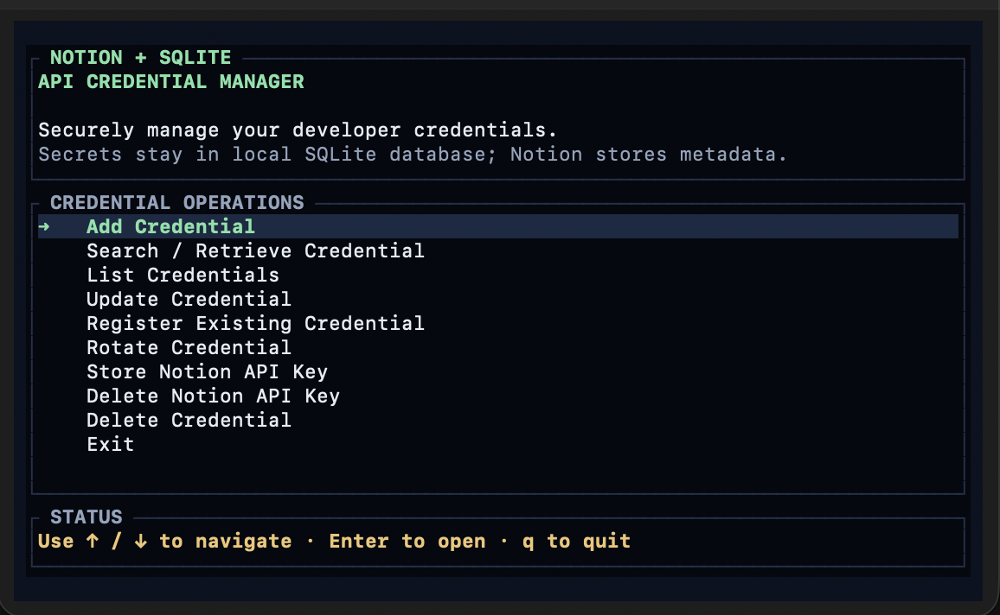

# QuantumData

A terminal UI for managing API credentials as Notion metadata while keeping the actual secrets in a local SQLite database.

Notion stores the inventory — name, purpose, owner, environment, rotation dates, and a local database reference. The secret value never leaves your machine. The app runs directly on your host, so copying a secret to the clipboard works through `pbcopy` on macOS.

> **Security note:** secrets and the Notion API key are stored unencrypted in a local SQLite file. See [Data and security](#data-and-security).

## Screenshot



*The main menu. Secrets stay in SQLite; Notion stores only metadata.*

## Features

- **Add credentials** — create a secret in SQLite and register the metadata in Notion, or link an existing local secret to a new Notion entry.
- **Search and inspect** — filter credentials by name, open a detail view, and copy the secret to the clipboard with `c`.
- **Update credentials** — edit every Notion metadata field from a prefilled form and optionally replace the secret stored in SQLite.
- **Delete credentials** — archives the Notion page and removes the matching local secret. Falls back to a unique title match when the stored reference is stale.
- **Notion API key management** — store or delete the Notion integration token from inside the app.
- **Startup splash** — an animated QuantumData splash; press any key to skip it.
- **Safe tests** — the test suite uses temporary databases and never calls Notion.

## How it works

```text
┌──────────────────────┐        ┌──────────────────────┐
│  Notion data source  │        │  Local SQLite        │
│                      │        │                      │
│  Name, Purpose,      │        │  secrets             │
│  Owner, Environment, │◀──────▶│  ├─ id               │
│  Rotation, Reference │        │  ├─ title            │
│  (metadata only)     │        │  ├─ secret           │
└──────────────────────┘        │  └─ created_at       │
                                │  meta                │
                                │  └─ notion-api-key   │
                                └──────────────────────┘
```

Each Notion entry stores a `Credential Reference` such as `sqlite://<uuid>`. The app resolves that reference to a row in the `secrets` table. Secrets are never written to Notion.

## Requirements

- **Rust 1.85 or newer** (the crate uses the 2024 edition). Install with [rustup](https://rustup.rs/).
- A C compiler for the bundled SQLite build:
  - macOS: Xcode Command Line Tools (`xcode-select --install`)
  - Debian/Ubuntu: `sudo apt install build-essential`
- **Notion workspace and integration** with access to a database that has the properties listed below.
- macOS is the primary target. Linux builds, but clipboard support depends on `pbcopy`; without it the app prints the secret to the terminal instead (see [Data and security](#data-and-security)).

## 1. Create the Notion integration

1. Open <https://www.notion.so/my-integrations> and create a new internal integration.
2. Under **Capabilities**, enable:
   - Read content
   - Update content
   - Insert content
3. Copy the integration token. You will paste it into the app on first run; it is stored in SQLite, not in `.env`.

## 2. Prepare the Notion database

Create a database (or use an existing one) with these property names and types. Property names must match exactly.

| Property | Type | Notes |
| --- | --- | --- |
| `Name` | Title | Credential display name |
| `Status` | Select | The app writes `Active` when creating a credential |
| `Purpose` | Rich text | What the credential is for |
| `Credential Reference` | Rich text | Set automatically, e.g. `sqlite://<uuid>` |
| `Environment Variable` | Rich text | e.g. `OPENAI_API_KEY` |
| `Environment` | Select | e.g. `Local`, `Production` |
| `Repository` | Rich text | e.g. `owner/repo` |
| `Owner` | Rich text | Person or team responsible |
| `Rotation Frequency` | Select | e.g. `Every 90 days` |
| `Last Rotated` | Date | `YYYY-MM-DD` |
| `Next Rotation Due` | Date | `YYYY-MM-DD` |

Then share the database with the integration:

1. Open the database as a full page in Notion.
2. Open the `•••` menu → **Connections** → **Connect to** → select your integration.
3. Confirm the integration can access the database.

## 3. Get the data source ID

This project uses Notion API version `2025-09-03`, where pages live under a **data source**, not directly under a database. The app expects `NOTION_DATA_SOURCE_ID` — the data source ID, not the database page ID.

With the database shared to your integration, fetch its data sources:

```bash
export NOTION_TOKEN="secret_your_integration_token"
export DATABASE_ID="the_32_character_database_id_from_the_notion_url"

curl -s "https://api.notion.com/v1/databases/${DATABASE_ID}" \
  -H "Authorization: Bearer ${NOTION_TOKEN}" \
  -H "Notion-Version: 2025-09-03" \
  | jq '.data_sources'
```

Copy the `id` of the first data source. If `data_sources` is empty or the request returns `object_not_found`, the database has not been shared with the integration yet.

## 4. Configure the app

Clone the repository and enter it:

```bash
git clone https://github.com/Datanerdbytes/quantumdata-credential-manager.git
cd quantumdata-credential-manager
```

Create your local environment file:

```bash
cp .env.example .env
```

Edit `.env`:

```dotenv
# Required: Notion data source ID from step 3
NOTION_DATA_SOURCE_ID=xxxxxxxx-xxxx-xxxx-xxxx-xxxxxxxxxxxx

# Optional but recommended: absolute path so every launch uses the same database
DB_PATH=/absolute/path/to/notion-api-credential-manager/data/credentials.db
```

Notes:

- The app loads `.env` from the current directory or one of its parents via `dotenvy`. Run it from the project directory, or export the variables in your shell.
- `DB_PATH` defaults to `credentials.db` in the current working directory. Use an absolute path to avoid accidentally creating a second database when launching from a different folder.
- `NOTION_DATABASE_ID`, `NOTION_API_KEY_OP_REF`, and `ONEPASSWORD_VAULT` are legacy 1Password-era variables and are not used.
- `.env`, `data/`, and `credentials.db` are gitignored. Never commit them.

Create the data directory if it does not exist:

```bash
mkdir -p data
```

## 5. Build and run

Run directly from the source tree:

```bash
cargo run --release
```

Or install the binary once and launch it by name:

```bash
cargo install --path . --force
api-manager
```

`cargo install` places `api-manager` in `~/.cargo/bin`. Make sure that directory is on your `PATH`.

On first launch:

1. Wait for the QuantumData splash, or press any key to skip it.
2. Choose **Store Notion API Key** and paste the integration token.
3. Choose **Add Credential** to create your first entry.

## Usage

### Menu

| Key | Action |
| --- | --- |
| `↑` / `↓` | Move the highlight |
| `Enter` / `Space` | Open the highlighted action |
| `q` | Quit from the main menu |

### Forms

| Key | Action |
| --- | --- |
| Any character | Edit the active field |
| `Tab` / `Shift+Tab` | Next / previous field |
| `↑` / `↓` | Previous / next field |
| `Enter` | Continue or save |
| `Esc` | Go back without saving |

Dates must use `YYYY-MM-DD` (an ISO timestamp such as `2026-01-01T10:00:00Z` is also accepted).

### Lists and details

| Key | Action |
| --- | --- |
| `↑` / `↓` | Navigate or scroll |
| `Enter` | Open the selected item |
| `Esc` | Go back |
| `r` | Refresh the Notion list (List screen only) |
| `c` | Copy the selected secret (Details screen) |
| `q` | Return to the main menu |

### Credential flows

- **Add Credential**
  - *Create a new credential* — enter metadata, then the secret. The app creates the SQLite row first, then the Notion page.
  - *Use an existing credential* — pick a secret already in SQLite and register new metadata in Notion.
- **Search / Retrieve Credential** — filter as you type, open details, press `c` to copy.
- **List Credentials** — browse everything in Notion; press `r` to refresh.
- **Update Credential** — choose an entry, edit the prefilled metadata, then optionally type a replacement secret. Leave the secret field empty and press `Enter` to keep the current secret.
- **Register Existing Credential** — create a Notion entry for a local secret without re-entering it.
- **Store / Delete Notion API Key** — manage the integration token in SQLite.
- **Delete Credential** — archives the Notion page and deletes the local secret. If the stored reference is stale, the app falls back to a unique case-insensitive title match; if several secrets share that title, it refuses to guess.

## Data and security

- **Secrets are stored in plaintext.** The `secrets.secret` column and the Notion API key in `meta.value` are not encrypted. Protect the database:
  ```bash
  chmod 600 data/credentials.db
  ```
  Prefer full-disk encryption (FileVault on macOS) and restrict access to your user account.
- **Notion never receives secret values.** Only metadata and the `sqlite://<uuid>` reference are sent.
- **Clipboard fallback can leak secrets.** If `pbcopy` is unavailable (for example inside a container or on Linux), the app prints the secret to stdout. Do not run the copy action while screen sharing or recording.
- **Run it on the host.** Containerized environments cannot access the macOS clipboard the way the app expects.
- **Back up** `data/credentials.db` if you care about the stored secrets. Notion holds only the metadata.
- **Do not commit** `.env`, `data/`, or `credentials.db`; they are already listed in `.gitignore`.

## Troubleshooting

| Symptom | Fix |
| --- | --- |
| `Missing NOTION_DATA_SOURCE_ID environment variable` | Create `.env` from `.env.example`, set the data source ID, and launch from the project directory (or export the variable). |
| `Notion API key not found in database. Run the app to store it first.` | Use **Store Notion API Key** in the menu. |
| `Notion API error (object_not_found)` | The integration lacks access, or the ID is wrong. Share the database with the integration and use the data source ID, not the database page ID. |
| `Notion API error (validation_error)` | A property name or type does not match the table in [Prepare the Notion database](#2-prepare-the-notion-database), or a select/date value is invalid. |
| `No secret found for reference ...` | The Notion reference points to a missing row. Correct the `Credential Reference`, or rely on the title fallback when the title is unique. |
| Credential disappears between launches | Two databases are in use. Set an absolute `DB_PATH` and remove stray `credentials.db` files. |
| Delete says the title is ambiguous | Multiple local secrets share that name. Rename one or fix the `Credential Reference` in Notion. |
| Clipboard message says the secret was printed | `pbcopy` is unavailable. Run the app directly on macOS, and clear the terminal afterwards. |
| Splash slows down scripts | It lasts 1.5 seconds and exits on any key. |

## Development

```bash
cargo fmt
cargo test
```

The suite currently contains 42 tests covering metadata mapping, update property clearing, SQLite updates and deletes, and TUI state transitions. Tests use temporary databases and do not touch your real database or the Notion API.

Project layout:

```text
src/
├── main.rs              # Entry point
├── cli.rs               # Terminal UI, screens, splash animation
├── config.rs            # .env loading and database path
├── models/              # Credential model
├── notion/
│   ├── client.rs        # Notion HTTP client (API 2025-09-03)
│   └── credentials.rs   # Notion property mapping and CRUD helpers
└── secrets.rs           # SQLite storage and clipboard integration
```

## Limitations

- **Rotate Credential** is present in the menu but not implemented yet.
- Secrets are not encrypted at rest.
- The clipboard fallback prints secrets to stdout when `pbcopy` is missing.
- Notion integration tokens and secrets must be provisioned manually; there is no import or export command.

## License

Released under the [MIT License](LICENSE).

Copyright (c) 2026 QuantumEcho
